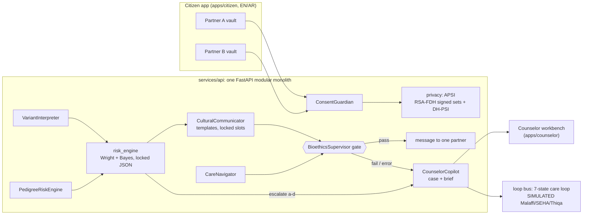

# évolvé: inherited disease risk, explained (product name TODO(team))

Abu Dhabi Future Health Digital Innovation Challenge, Fertility track: *Understanding and Reducing Inherited Disease Risk*.

> **Decision support, not a diagnosis or medical advice.** It runs on synthetic data only. No real person's data is in this repo, and no number here is a clinical result. Government integrations (Malaffi, SEHA, Thiqa, Judicial Department) are **SIMULATED** behind adapters.

## What évolvé is
évolvé is a privacy-preserving, **non-directive** decision-support prototype for premarital and preconception carrier results. Each partner's results stay in a private vault. If both partners consent, an **Authorized Private Set Intersection (APSI)** check shows the couple only the genes they *both* carry. Deterministic code computes consanguinity (Wright) and Bayesian residual risk, and then locks the numbers. The explanation comes from templates in English and Arabic, and every message passes a bioethics gate before it is sent. Complex cases go to a human genetic counselor. The care loop is tracked until a human closes it. We measure comprehension, informed choice, care-loop speed, calibration and privacy. We **never** measure marriages cancelled (docs/00-CHARTER.md; source §1).

## The problem (from the source document, `docs/source/architecture-source.txt`)
| Fact | Source |
|---|---|
| Abu Dhabi's mandatory premarital screening uses 30X WGS across **570 genes** linked to **>840** autosomal recessive conditions | source Intro |
| **565 of 11,748** couples screened (2022 pilot to July 2026) were genetically incompatible, about **4.8%** | source Intro, §1 |
| **52%** of P/LP variants found in Emirati families are absent from gnomAD and **30%** from ClinVar | source Intro, §2.1 |
| Sharing carrier reports naively can expose a partner's discordant variants without consent | source Intro, §3.2 |
| Up to **78%** of people tested carry at least one recessive variant, but only **4.8%–13.1%** of couples share one in the same gene | source §3.2 |
| The health certificate goes to the Judicial Department **regardless** of the genetic result | source §1, §3.4 |

Screening only helps when people **understand** their result and **reach** counseling and care (source Intro).

## Architecture

Code does all the math, set logic and consent checks. Language models only write words, and only from locked JSON (AGENTS.md §2; source §4). LLM paraphrase is **hard-off**. Every patient message is a pre-approved template filled with locked values, and it still passes the gate (DECISIONS #37, #49).

## How the privacy works, in plain words
1. The screening authority signs each partner's carrier gene list. A partner cannot invent genes to probe the other's genome (source §3.2; DECISIONS #5).
2. Each side scrambles its own signed list with a secret key and the two sides swap the scrambled lists. Matching scrambled items shows a gene both partners carry. An item without a match reveals nothing (DH-commutative PSI over the RFC 3526 2048-bit group; services/privacy/THREAT_MODEL.md).
3. If nothing matches, both partners see only **"Compatible"**. If something matches, they see only the shared gene, in a couple workspace that both of them consented to.
4. The check runs only with two valid, unexpired consents. Withdrawing consent purges the couple workspace (P-07), and this is tested.

What it does **not** protect against: a partner who cheats inside the protocol; the two list sizes, which are revealed; key custody, since keys live in memory and are lost on restart (THREAT_MODEL.md; DONE-P1-PA).

## The seven runtime agents (fixed roster, G-03)
| Agent | Does | Never does |
|---|---|---|
| ConsentGuardian | checks both consents, runs APSI, scopes tokens | lets APSI run on one consent |
| VariantInterpreter | parses calls and flags complex loci (CYP21A2, SMN1, HBA2) | classifies variants itself |
| PedigreeRiskEngine | calls `risk_engine` (Wright R/F, Bayes) and verifies the locked digest | does arithmetic in a prompt |
| CulturalCommunicator | fills EN/AR templates with locked display strings | invents a number |
| CareNavigator | lists care options unranked, checks ART/Thiqa eligibility | ranks options or recommends a decision |
| BioethicsSupervisor | gates every outbound message: numeric drift, leakage, directive, UAE law, judicial statement, stigma, false reassurance; fails closed | lets a gate error send a message |
| CounselorCopilot | opens a human case on triggers (a)–(d) and the gate trigger, and builds the Consultation Brief | auto-clears a case |

## Guardrails (summary of docs/01-GUARDRAILS.md)
- **No LLM arithmetic** (P-01/P-02). Every number shown must exist verbatim in the locked `RiskOutput` (contracts/risk_output.schema.json v1.1.0).
- **No cross-partner leakage** (P-06/P-08). Each user has their own context. The couple workspace holds only the intersection.
- **Non-directive** (P-13–P-15). No advice on marrying, not marrying or ending a pregnancy. Every result says the certificate is issued regardless. There is no marriage-outcome metric.
- **Designed to comply with UAE reproductive law (pending legal review)** (P-16). No donor gametes. PGT-M needs the written consent of both spouses. Fetal-anomaly questions go to an MFM physician and a genetic counselor, with no advice given.
- **Escalate, don't reassure** (P-04/P-05/P-18). A screen-negative partner is never told "no risk".
- **Synthetic only** (P-11). No secrets, and no gene symbols in logs (P-12).
- Enforced by `scripts/guardrail_check.py`, the red-team suites in `tests/guardrails/` and the golden vectors in `tests/golden/`.

## Status (2026-11-16)
- All charter surfaces are built:
  - citizen app (11 surfaces, EN/AR)
  - counselor workbench
  - eval dashboard with the live gate probe
  - backend for API contract v1.2.1
- **G2 passed as redefined** (DECISIONS #37, #51). Patients receive only pre-approved templates. Template closure: 25,692 template × record combinations, 0 failures. 17 tests prove there is no free-text path to patients. The free-text gate's held-out score is tracked honestly (see the test matrix).

## Quickstart (one command)
Prerequisites: Python 3.13 with the packages in `scripts/allowed_deps.txt`, and Node 22 with `npm ci` run once at the repo root.
```bash
powershell -ExecutionPolicy Bypass -File scripts\demo\run_local.ps1    # Windows
scripts/demo/run_local.sh                                               # bash
```
This starts the backend (:8000), citizen (:3000), counselor workbench (:3001) and eval dashboard (:3002). It then resets the demo, pre-stages V3, and prints the partner IDs, the counselor login and the URLs. Options: `-Mock` runs offline (SIMULATED mock adapters, no backend); `-Stop` stops everything; `scripts\demo\reset_demo.ps1` resets between runs.

Manual start: `uvicorn evolve_api.main:app --app-dir services/api --port 8000`, then `npm run dev` in each app with `NEXT_PUBLIC_API=http://localhost:8000`.

Docker: `deploy/docker-compose.yml`. Its config validates, but the images have not been built or tested, and it does not yet include the eval dashboard.

Demo materials: [DEMO-SCRIPT](docs/demo/DEMO-SCRIPT.md) · [PITCH-OUTLINE](docs/demo/PITCH-OUTLINE.md) · [JUDGE-QA](docs/demo/JUDGE-QA.md) · [CLAIMS-LEDGER](docs/demo/CLAIMS-LEDGER.md) · [RUNBOOK](docs/demo/RUNBOOK.md).

## Test matrix (real results; source = evidence pack `services/eval/out/evidence.json` build 2026-11-15T06:03Z unless noted)
| Suite | Result | Source |
|---|---|---|
| risk_engine | 76/76 | pack `tests` |
| Arithmetic calibration (2 independent oracles) | **0 mismatches / 629 records**, 1,000 synthetic couples + V1–V5 | pack `dimensions.calibration` |
| privacy (APSI, consent, audit, cascade) | 44/44 | pack `tests` |
| fhir | 49/49; 0 errors on our harness over 1,000 couples. HL7 validator CLI: 8 errors, all tx.fhir.org timeouts (inconclusive, not rejections) | pack; DECISIONS #42 |
| synth | 21/21; cohort concordance 3.40% (8-gene floor, not tuned) | pack; DONE-P1-DS2 |
| agents / api / loop | 341/341 · 27/27 · 8/8 in the pack; later runs api 28, agents 369 | pack; DECISIONS #53 |
| Template closure (G2 a) | **25,692 template × record combinations, 0 failures** (EN + AR, full cohort) | DONE-P4-GATE; DECISIONS #51 |
| No free-text path to patients (G2 b) | 17/17 | DONE-P4-GATE; DECISIONS #51 |
| Red-team regression corpus | 540/540 (433/433 adversarial, 0/93 FP) after gate round 3; the pack predates it (518/540) | DECISIONS #51 |
| **Red-team held-out v2 (unseen)** | **113/181 = 62.4% caught, 2/43 = 4.7% FP**, below the ≥95% / ≤5% target. Tracked, not a blocker, because patient text is closed templates | pack `redteam`; DONE-P4-QA-HOLDOUT2 |
| Held-out v1 (retired) | round 1: 65.3% / 15.9% FP → final: 89.6% / 2.3% FP | DONE-P2-QA-HOLDOUT; DONE-P4-QA-HOLDOUT2 |
| Live leakage scan | 0 leaks / 2,491 partner-addressed API responses | pack `dimensions.privacy` |
| Integration / eval / guardrail-script | 28/28 · 20/20 · 3/3; `guardrail_check: OK` | pack |
| Citizen app | live e2e 21 passed; axe 0 serious on every route EN + AR. **JS budget ≤180 kB not met (210–264 kB); Lighthouse not run** | DONE-P3-UI-CIT |
| Counselor workbench | 27 Playwright (mock) + 2 live; 48 axe checks, 0 serious | DONE-P3-UI-CNS |
| Eval dashboard | 17 Playwright; axe 0 | DONE-P4-UI-EVAL |
| **Gate 3 E2E: PASSED, 0 P0** | citizen live 21 passed; counselor 27 + 2 live; eval 17; cross-app smoke (V1 result → counselor trigger-(a) case → eval gate probe holds a V4B leak) 1 passed | DONE-G3-QA (2026-11-16) |
| Persona metrics (**SIMULATED**) | teach-back first attempt 62.1% (target 85%), after re-explanation 92.1%; SURE 4/4 87.1% (target 90%); 39/39 booked ≤48 h; 98.9% confirmatory done; GCOS-24/GOS not instrumented | pack `dimensions` |

Run them:
```bash
python scripts/guardrail_check.py
cd services/risk_engine && python -m pytest -q      # likewise services/{synth,privacy,fhir,agents,api,loop}
python -m pytest tests -q                            # red-team + integration + eval (held-out failures are expected and reported)
python -m services.eval                              # rebuild the evidence pack (SIMULATED personas)
```

## Limitations and what is simulated (please read)
- **All data is synthetic.** The 1,000-couple cohort and the five vignettes V1–V5 are calibrated to published Emirati carrier frequencies (source §2.1), but nobody in them is real.
- **Simulated:** sign-in (no national digital ID), Malaffi/SEHA/Thiqa/Judicial adapters, booking and the 48 h timer clock, partner consent in the demo (`simulate-partner-consent`), and every comprehension, SURE and GCOS figure (simulated personas, never clinical findings; charter honesty rule).
- **The free-text gate does not generalise well.** On an unseen held-out set it catches 62.4% of adversarial drafts (4.7% FP), against a ≥95% target. The product's guarantee therefore rests on structure: patients receive only pre-approved templates (verified exhaustively), LLM paraphrase is hard-off, and escalation never depends on wording (DECISIONS #37, #49). The gate still guards the counselor-authored text and the demo probe.
- **Assay detection rates** (0.92 / 0.99) are inferred from the source's published outputs and need confirmation from the authors (DECISIONS #1, TODO(verify)). The related concordant-negative formula is not implemented; it returns "needs counselor" with no number (DECISIONS #2).
- **8 genes, not 570.** The demo panel is the source's gene table. Couple concordance on 8 genes is a floor, not the program's 4.8% (DECISIONS #10, #22).
- **Arabic:** the patient copy (71 strings) is real Arabic, marked TODO(native-review), and has not yet been reviewed by a native clinician. Counselor and eval-dashboard Arabic are English placeholders (DECISIONS #48, #50).
- **FHIR conformance:** our harness reports 0 errors. The HL7 validator has 8 remaining errors, all terminology-server timeouts (inconclusive). phenopacket-tools has not been run on our files (DECISIONS #42).
- **UI quality bars not met:** the citizen JS budget and Lighthouse (DONE-P3-UI-CIT). The eval dashboard shows a stale evidence copy until REQUEST-DD-1 lands.
- **Legal statements** describe what the gate is designed to enforce. They are not legal advice and are pending review by counsel.
- There is no clinical validation of any kind. See the roadmap (docs/05 §4, S0–S4).

## Repository map
| Path | Owner |
|---|---|
| `docs/` (charter, guardrails, design, testing, rollout, build plan, math spec, decisions) | orchestrator |
| `services/risk_engine`, `services/privacy`, `services/fhir`, `services/synth` | risk-engine, privacy-apsi, fhir-interop, data-synth |
| `services/api`, `services/agents`, `services/loop` | agent-runtime |
| `apps/`, `packages/ui`, `design/` | ui-frontend |
| `tests/`, `services/eval` | qa-redteam |
| `docs/demo/`, this README | docs-demo |

Operating contract for every AI build agent: [AGENTS.md](AGENTS.md). Source of truth: `docs/source/architecture-source.txt`.
